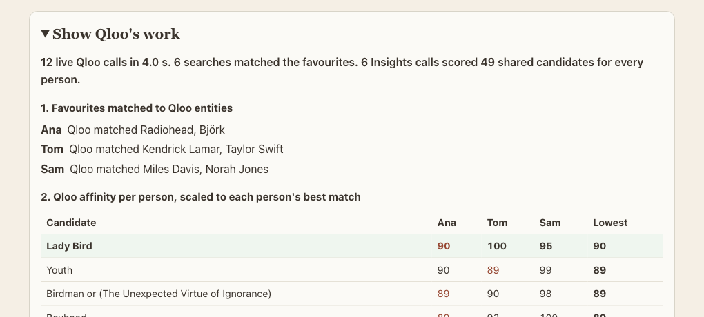

# Common Ground

**One pick a whole group will enjoy, without leaving one person behind.**
Each person names a few things they love. Qloo scores every candidate for every person.
Common Ground picks the option whose least happy person is happiest.

[**Open the live app**](https://common-ground.lipmichal.workers.dev) · [Demo video (1.5 min)](https://youtu.be/IWAe4__XueA) · [MCP endpoint](https://common-ground.lipmichal.workers.dev/mcp) · [Live mode check](https://common-ground.lipmichal.workers.dev/health)


## Why it needs Qloo

- **Cross-domain taste.** Favourites can come from one domain and the pick from another. Three friends list only music artists. Qloo picks a film or a restaurant in Lisbon from that music taste. With "Anything", one person can give a band and a book, and another a film and a TV show. An LLM alone cannot score that link per person.
- **A real score for every person.** Qloo Insights gives each person an affinity for every finalist. The app needs those per-person scores to protect the least happy person.
- **Nothing is made up.** Every favourite is matched with Qloo search. Unknown names are reported, never guessed. A failed live call shows an error, not fake data.

## Try it in 30 seconds

1. Open the [live app](https://common-ground.lipmichal.workers.dev). The "Movie from music taste" group is ready.
2. Press **Find our common ground**.
3. Open **Show Qloo's work**. It shows the live call count, the matched Qloo entities and the score of each finalist for each person.
4. Try "Dinner in Lisbon from playlists" for a restaurant from the same music taste.
5. Try "Mixed tastes, one TV show". Each favourite can be a band, a film, a show or a book.

No login is needed.



## Use it from an agent

The same flow is the MCP tool `find_common_ground` on a Streamable HTTP endpoint.

```sh
claude mcp add --transport http common-ground https://common-ground.lipmichal.workers.dev/mcp
```

Then ask your agent, for example "Ana loves Radiohead and Bjork, Tom loves Kendrick Lamar and Taylor Swift. Find us a restaurant in Lisbon."
The tool input is `kind`, an optional `tasteFrom` (a category, or `any` for mixed favourites), an optional `location` and 2 to 8 `members` with 2 to 5 `likes` each.
The tool returns the pick, three alternatives, a reason per person and a trace of the Qloo calls.

Built for the [Qloo Agentic Hackathon](https://qloo.devpost.com) by Michael Lip. MIT license.

## Setup

Use Node.js 22 or later and npm.

```sh
npm ci
npm test
npm run typecheck
npm run dev
```

Open the local URL printed by Wrangler.
Without a key, the app runs on local synthetic fixtures (see below).

For local live mode, place the key in `.dev.vars`.
Use a line with the variable name and your actual value.
Keep this file private.

```dotenv
QLOO_API_KEY=YOUR_API_KEY
```

## How Qloo drives the pick

The Worker reads `QLOO_API_KEY` from its environment.
On Cloudflare this value is a Worker secret.
The browser never receives the key.

1. `GET /search` resolves each favourite with `query` and `types`. With `tasteFrom`, favourites resolve in that category, for example music artists.
2. `GET /v2/insights` runs separately for each person.
3. Each Insights request sends `filter.type`, `signal.interests.entities` and `take=50`.
4. Restaurant requests also send `filter.location.query` and `filter.tags=urn:tag:genre:place:restaurant`, so museums and stations drop out.
5. The client reads each entity's `query.affinity` in the documented zero to one range.
6. The tool pools the top candidates of every person, up to 50 IDs.
7. A second Insights call per person scores that pool with `filter.results.entities`.
8. Each person's scores are divided by their own highest affinity.
9. A candidate that Qloo does not score for a person gets zero for that person.
10. The tool removes known favourites and picks the highest minimum score.

The key travels only in the `X-Api-Key` request header.
Hackathon calls use `https://hackathon.api.qloo.com`.
Calls time out after five seconds.
Calls are spaced to stay under the hackathon limit of 10 requests per second.
A 429 answer is retried twice after one second.
Authentication, quota and network errors are reported.
A failed live call never switches to fixtures.

See the [search reference](https://docs.qloo.com/reference/get-search),
[Insights reference](https://docs.qloo.com/reference/insights-api-deep-dive)
and [hackathon developer guide](https://docs.qloo.com/reference/qloo-llm-hackathon-developer-guide).

## Running without a key

This is for local development only. The hosted app uses live data.
Without a key, the same Qloo client reads local synthetic fixtures.
The same resolution and fairness code runs in both modes.
The page banner, result note, JSON response and MCP response show the mode.
Fixture affinities and IDs are invented.
They are not evidence of Qloo recommendations or real user preferences.
No captured Qloo response data is published.

[The fixture file](src/fixtures/qloo.ts) cites the documented response schemas.
Search returns `success`, `duration` and a `results` array.
Insights returns `success` and `results` with `entities` and `duration`.
Each Insights entity has `query.affinity`.

The examples cover movies, books, restaurants, artists and TV shows.
Only names listed in the fixture catalogue resolve without a key.
Unknown names are reported rather than invented.
Fixture restaurants are fictional and limited to the Warsaw example.
Their names do not imply that a real venue exists.

## Deploy

Authenticate Wrangler with your own Cloudflare account.

```sh
npm run deploy
npx wrangler secret put QLOO_API_KEY
npm run verify:live -- https://YOUR-WORKER.workers.dev
```

The secret command prompts for the key.
It updates the deployed Worker without storing the key in source.
The verification command checks the mode and performs a real group pick.
It prints no credentials and stores no Qloo data.

`GET /health` reports the selected mode and whether a key is configured.
A live health response alone proves configuration.
A successful live pick confirms that Qloo answered.

## Agent access

Connect a Streamable HTTP MCP client to `/mcp` on the deployed host.
List tools and call `find_common_ground` with the same input as `/api/pick`.

```json
{
  "kind": "movie",
  "members": [
    { "name": "Ana", "likes": ["Prisoners", "Gone Girl"] },
    { "name": "Tom", "likes": ["Interstellar", "Inception"] }
  ]
}
```

Add `"tasteFrom": "artist"` to pick a movie from music favourites.

The tool returns structured results and plain text.
It is read only and does not book venues or buy media.

## Limits

Groups have two to eight people with different names.
Each person supplies two to five favourites.
Restaurants require a city and named venues as favourites.
Cuisine words are not treated as restaurant entity IDs.
Search takes the first result of the requested type.
It does not ask users to confirm ambiguous matches.

Each person gets at most 50 candidates.
A missing result is treated as zero, which may reflect limited coverage.
The method does not score every possible candidate for every person.
A second Insights pass scores a shared pool of up to 50 candidates for each person, so a zero minimum is rare.
Match scores are relative within each person's returned list.
They are not probabilities of enjoyment.
Reasons use shared tags when available and a named input otherwise.
They are not model-generated explanations of causality.

Restaurant results can still include bars and cafes that Qloo tags as restaurants.
A request can make up to 40 searches and 16 Insights calls.
The public endpoint has no application rate limiter or persistent cache.
Qloo limits can return HTTP 429.
The app has no accounts and stores no submitted group profiles.
Favourite names and entity IDs are sent to Qloo in live mode.
Member names stay within the app request.
API availability after the hackathon depends on Qloo access.

## Checks

`npm test` uses fixture responses and fake fetch functions.
It never calls Qloo.
Tests cover fairness, pool scoring, input errors, auth errors, rate limits, timeout handling, fixture replay and MCP calls.

```sh
gitleaks detect --source . --redact --no-banner
gitleaks detect --no-git --source . --redact --no-banner
```

The scan configuration allows only literal guide placeholders and local ignored documentation HTML.
MIT covers the source code.
Qloo service access and data remain subject to Qloo terms.
