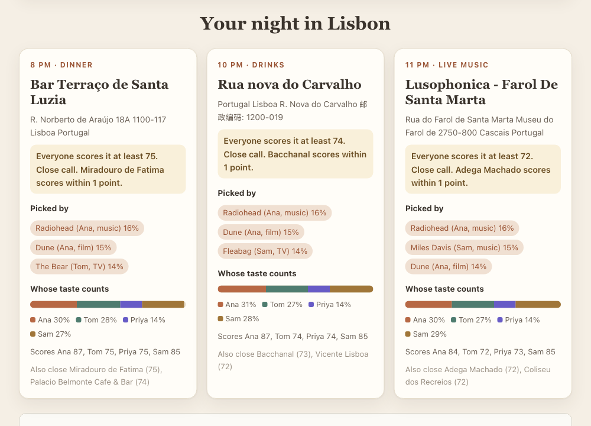

# Common Ground

**Plan a night out your whole friend group will love.**
For friends who argue about where to go. Everyone names a few bands, films, shows or books they love.
Qloo's cross-domain taste graph turns that shared taste into dinner, drinks and live music in your city.
Each stop names the favourites that picked it and shows how much each friend's taste counts.

[**Open the live app**](https://common-ground.lipmichal.workers.dev) · [MCP endpoint](https://common-ground.lipmichal.workers.dev/mcp) · [Live mode check](https://common-ground.lipmichal.workers.dev/health)

The [earlier 85-second video](https://youtu.be/npgyKhITMVI) and screenshots below show the interface before the optional date field. The video also uses older score and time labels. Use the app and the current limits below to assess present behavior.



## Why it needs Qloo

- **Taste in one domain picks places in another.** Nobody in the group names a restaurant or a bar. Ana gives Radiohead and Dune, Tom gives Kendrick Lamar and The Bear. Qloo links that music, film and TV taste to real venues in the city. A search engine or an LLM alone has no per-person score for that link.
- **Qloo says why.** Each stop uses Qloo's `feature.explainability`. The app names the favourites that drove the pick ("Radiohead, Ana, 16%") and splits the pick between friends. When one friend's taste barely counts, the app says so and asks for one more favourite.
- **A real score for every friend.** Qloo Insights gives each friend an affinity for every candidate venue. Each stop is the venue whose least happy friend is happiest. Scores are raw Qloo affinity, so real gaps stay visible and close calls are labelled.
- **Nothing is made up.** Every favourite is matched with Qloo search. Unknown names are reported, never guessed. A failed live call shows an error, not fake data.

## Try it in 30 seconds

1. Open the [live app](https://common-ground.lipmichal.workers.dev). "Night in Lisbon" is ready with four friends.
2. Optionally choose a date, then press **Plan our night**. A selected date filters venues by its weekday. Exact opening hours and availability are not checked. A request usually takes about 4 to 9 seconds.
3. Read the three stops. "Picked by" names the favourites behind each venue. "Whose taste counts" shows each friend's share.
4. Open **Show Qloo's work** for the live call count and the matched Qloo entities.
5. Try "Birthday in New York" or "Team night in London", or type your own friends.

Below the night planner, "Or pick one thing together" picks one movie, show, book, artist or restaurant the same fair way. No login is needed.


## Use it from an agent

Both flows are MCP tools on one Streamable HTTP endpoint, `plan_night_out` and `find_common_ground`.

```sh
claude mcp add --transport http common-ground https://common-ground.lipmichal.workers.dev/mcp
```

Then ask your agent, for example "Plan a night out in Lisbon. Ana loves Radiohead and Dune, Tom loves Kendrick Lamar and The Bear, Priya loves Phoebe Bridgers and Normal People."
`plan_night_out` takes a `city`, 2 to 6 `members` with 1 to 4 `likes` each, and an optional `date` in `YYYY-MM-DD` form. It returns the available stops, the favourites behind each, each friend's share, a call trace and `dateScope`. A plan can be incomplete if Qloo cannot find all three stops.
`find_common_ground` input is `kind`, an optional `tasteFrom` (a category, or `any` for mixed favourites), an optional `location` and 2 to 8 `members` with 2 to 5 `likes` each.
The tool returns the pick, three alternatives, a reason per person and a trace of the Qloo calls.

Registry name `io.github.theluckystrike/common-ground` in the [official MCP registry](https://registry.modelcontextprotocol.io/v0/servers?search=io.github.theluckystrike/common-ground).

Built for the [Qloo Agentic Hackathon](https://qloo.devpost.com) by Michael Lip. MIT license.

## Setup

Use Node.js 22 or later and npm.

```sh
npm ci
npm test
npm run typecheck
npm run dev
```

Open the local URL printed by Wrangler.
Without a key, the app runs on local synthetic fixtures (see below).

For local live mode, place the key in `.dev.vars`.
Use a line with the variable name and your actual value.
Keep this file private.

```dotenv
QLOO_API_KEY=YOUR_API_KEY
```

## How Qloo plans the night

1. `GET /search` resolves each favourite across artists, movies, TV shows and books. Each favourite keeps the type Qloo returns.
2. For each stop (dinner, drinks, live music), one `GET /v2/insights` call sends everyone's favourites as `signal.interests.entities`, `filter.type=urn:entity:place`, `filter.location.query` with the city, a stop tag and `feature.explainability=true`. Stop tags are `urn:tag:genre:place:restaurant`, `urn:tag:category:place:bar` and `urn:tag:genre:place:live_music_venue`.
3. The group call asks for 30 venues inside the city (`filter.location.radius=0`). The app keeps up to 20 real venues. A venue needs opening hours in Qloo and a category that fits the stop, such as a restaurant for dinner. Shops, malls, markets and event rentals are dropped, and so are streets and districts. Dinner prefers restaurants that are not also bars or cafes, and live music prefers music venues that are not also restaurants. Each falls back to mixed venues only when a city has fewer than 3 pure ones. One more Insights call per friend scores that pool with `filter.results.entities`. With a selected date, every group and per-person venue call also sends Qloo's documented `filter.hours` weekday value.
4. Each stop is the venue with the highest lowest raw affinity. The group average breaks ties. A venue is used only once in the night.
5. The winner's `query.explainability` scores name the favourites behind it. When Qloo weighs the favourites about equally, the app says the venue is a balanced compromise instead of showing near-equal percentages. Each friend's share is the sum of their favourites' scores. A shared favourite is split evenly.

A four-friend plan makes 8 searches and 15 Insights calls. The same plan within 30 minutes is answered from memory, so replays by judges do not spend the quota. The cache separates each selected calendar date from other dates and from an undated request.

## How Qloo drives the single pick

The Worker reads `QLOO_API_KEY` from its environment.
On Cloudflare this value is a Worker secret.
The browser never receives the key.

1. `GET /search` resolves each favourite with `query` and `types`. With `tasteFrom`, favourites resolve in that category, for example music artists.
2. `GET /v2/insights` runs separately for each person.
3. Each Insights request sends `filter.type`, `signal.interests.entities` and `take=50`.
4. Restaurant requests also send `filter.location.query` and `filter.tags=urn:tag:genre:place:restaurant`, so museums and stations drop out.
5. The client reads each entity's `query.affinity` in the documented zero to one range.
6. The tool pools the top candidates of every person, up to 50 IDs.
7. A second Insights call per person scores that pool with `filter.results.entities`.
8. Each person's scores are divided by their own highest affinity.
9. A candidate that Qloo does not score for a person gets zero for that person.
10. The tool removes known favourites and picks the highest minimum score.

The key travels only in the `X-Api-Key` request header.
Hackathon calls use `https://hackathon.api.qloo.com`.
Calls time out after five seconds, or nine seconds for explainability calls. A timeout is retried once.
Calls are spaced to stay under the hackathon limit of 10 requests per second.
A 429 answer is retried twice after one second.
Authentication, quota and network errors are reported.
A failed live call never switches to fixtures.

See the [search reference](https://docs.qloo.com/reference/get-search),
[Insights reference](https://docs.qloo.com/reference/insights-api-deep-dive)
and [hackathon developer guide](https://docs.qloo.com/reference/qloo-llm-hackathon-developer-guide).

## Running without a key

This is for local development only. The hosted app uses live data.
Without a key, the same Qloo client reads local synthetic fixtures.
The same resolution and fairness code runs in both modes.
The page banner, result note, JSON response and MCP response show the mode.
Fixture affinities and IDs are invented.
They are not evidence of Qloo recommendations or real user preferences.
The night plan tests use one small recorded set of real Qloo responses for a Lisbon group, trimmed to IDs, names, types, affinity and explainability.

[The fixture file](src/fixtures/qloo.ts) cites the documented response schemas.
Search returns `success`, `duration` and a `results` array.
Insights returns `success` and `results` with `entities` and `duration`.
Each Insights entity has `query.affinity`.

The examples cover movies, books, restaurants, artists and TV shows.
Only names listed in the fixture catalogue resolve without a key.
Unknown names are reported rather than invented.
Fixture restaurants are fictional and limited to the Warsaw example.
Their names do not imply that a real venue exists.

## Deploy

Authenticate Wrangler with your own Cloudflare account.

```sh
npm run deploy
npx wrangler secret put QLOO_API_KEY
npm run verify:live -- https://YOUR-WORKER.workers.dev
```

The secret command prompts for the key.
It updates the deployed Worker without storing the key in source.
The verification command checks the mode and performs a real group pick.
It prints no credentials and stores no Qloo data.

`GET /health` reports the selected mode and whether a key is configured.
A live health response alone proves configuration.
A successful live pick confirms that Qloo answered.

## Agent access

Connect a Streamable HTTP MCP client to `/mcp` on the deployed host.
List tools and call `find_common_ground` with the same input as `/api/pick`.

```json
{
  "kind": "movie",
  "members": [
    { "name": "Ana", "likes": ["Prisoners", "Gone Girl"] },
    { "name": "Tom", "likes": ["Interstellar", "Inception"] }
  ]
}
```

Add `"tasteFrom": "artist"` to pick a movie from music favourites.

The tool returns structured results and plain text.
It is read only and does not book venues or buy media.

## Limits

Night plans have two to six friends with one to four favourites each, and need a large enough city.
The optional date must be a real calendar date between 1900 and 9999. Its weekday is derived in UTC so the server's timezone cannot change the selected day. Incomplete native date input is rejected before a browser request is sent.
Qloo's weekday filter does not verify exact opening hours, holiday schedules, live availability, travel feasibility or event tickets. Suggested stop times are not reservations or a checked itinerary. With no date, there is no opening-day filter.
Explainability scores are often close together, so "Picked by" shows influence, not a single cause.
The venue check uses Qloo category tags and listed hours. It removes streets, districts, shops and markets, but in a small city a mixed venue, such as a restaurant that is also a bar, can still win.

Groups have two to eight people with different names.
Each person supplies two to five favourites.
Restaurants require a city and named venues as favourites.
Cuisine words are not treated as restaurant entity IDs.
Search takes the first result of the requested type.
It does not ask users to confirm ambiguous matches.

Each person gets at most 50 candidates.
A missing result is treated as zero, which may reflect limited coverage.
The method does not score every possible candidate for every person.
A second Insights pass scores a shared pool of up to 50 candidates for each person, so a zero minimum is rare.
Match scores are relative within each person's returned list.
They are not probabilities of enjoyment.
Reasons use shared tags when available and a named input otherwise.
They are not model-generated explanations of causality.

Restaurant results can still include bars and cafes that Qloo tags as restaurants.
A request can make up to 40 searches and 16 Insights calls.
The public endpoint has no application rate limiter or persistent cache.
Qloo limits can return HTTP 429.
The app has no accounts and stores no submitted group profiles.
Favourite names and entity IDs are sent to Qloo in live mode.
Member names stay within the app request.
API availability after the hackathon depends on Qloo access.

## Checks

`npm test` uses fixture responses and fake fetch functions.
It never calls Qloo.
Night plan tests replay recorded Qloo responses.
Tests cover the night plan, explainability shares, one venue per stop, fairness, pool scoring, input errors, auth errors, rate limits, timeout handling, fixture replay and MCP calls. Date checks cover real calendar validation, weekday request parameters, date-separated caching and the real Plan handler's refusal to send incomplete native input. These tests use fixtures; they do not prove a fresh live-provider result.

```sh
gitleaks detect --source . --redact --no-banner
gitleaks detect --no-git --source . --redact --no-banner
```

The scan configuration allows only literal guide placeholders and local ignored documentation HTML.
MIT covers the source code.
Qloo service access and data remain subject to Qloo terms.
